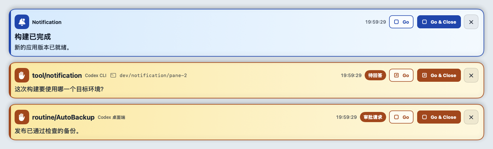

# Notification

**让提醒出现在每一块屏幕。**


macOS 菜单栏工具：将飞书等应用的系统通知同步镜像到所有连接屏幕的上方中央，并接收 Codex 桌面端与终端的审批、提问和任务完成提醒。每类通知都可独立关闭或设置停留时间；Codex 桌面端、其他应用和终端任务完成默认不通知，设置并保存后才启用。

这是实验版本。应用保留 macOS 原有通知，通过辅助功能观察新横幅，并用只读通知数据库补漏。Apple 没有为第三方应用提供公开的全局通知接管接口，界面结构、数据库和权限可能随系统版本改变；目前不能承诺接收率为 100%。

## 能做什么

- 每个连接屏幕同时显示浮层；默认宽 1320 点，高度随内容收紧、最高 156 点，较窄屏幕会限制宽度。飞书提醒默认约 10 秒后消失，Codex 终端审批与提问默认保留到处理或手动关闭；所有策略都可选「不通知」「定时消失」「等待处理」。
- 审批与提问使用暖黄色底，普通提醒使用浅蓝色底，配深色大字和加粗轮廓。「Go」为描边按钮，「Go & Close」为实心按钮。正文显示摘要：审批与提问最多三行，普通提醒最多两行，完整内容在来源应用查看。
- 浮层不会主动抢占键盘焦点；任意屏幕关闭一条提醒，会同步关闭其他屏幕上的同一条。右上角关闭按钮的点击区域为 40 × 40 点，叉号周围的空白也可点击。
- 常驻菜单栏，提供暂停、隐藏内容、测试提醒、最近提醒和可选的登录启动。
- 首次连接通知数据库只建立基线，不把已有历史通知重新弹出；新增通知和内容更新会被检测。
- Codex hooks 在审批、提问前发送提醒，在相应工具完成或会话继续后清除；启用任务完成通知后，本轮回复结束也可提醒，并可按多个项目目录过滤。通知工具不返回审批决定。
- 顶栏集中展示项目名、`session-name/window-name/pane-N`、通知时间、状态与操作；状态使用胶囊形标签，操作使用矩形按钮，底部不预留操作栏。时间按本机时区显示为 `HH:mm:ss`，悬停查看完整日期；数据库通知优先使用系统投递时间，横幅使用捕获时间，Codex 使用 hook 发生时间。

菜单栏图形为自行绘制的「提示灯＋双屏」，矢量源代码见 [Artwork.swift](Sources/NotificationApp/Artwork.swift)。



上图为实际浮层组件的合成内容预览；多屏实际显示仍需在设备上验收。

## 使用

### 构建、安装与更新

需要 Swift 工具链与 macOS Command Line Tools，无第三方包依赖。应用的最低构建目标为 macOS 13；不同 macOS 通知数据库的兼容性需要单独验证。

仅在这台 Mac 使用时，先创建固定的本地签名证书，并在 macOS 弹窗中确认其代码签名用途（只需配置一次）：

```bash
python3 scripts/local-signing.py init
python3 scripts/local-signing.py trust
```

随后在仓库根目录运行：

```bash
./scripts/build-app.sh
ditto build/Notification.app /Applications/Notification.app
open /Applications/Notification.app
```

首次安装及后续更新统一使用 `/Applications/Notification.app`。更新前先从菜单栏退出应用，再执行上述命令。

本地构建使用固定自签名证书，未作 Developer ID 签名或公证。证书、私钥钥匙串和专用解锁密码保存在当前用户的 `~/Library/Application Support/Notification/Signing/`，不写入仓库；私钥导入后不可导出，只供本地签名。不要删除或重新生成这套签名材料，否则应用身份会再次改变。构建时如果材料缺失、证书过期或签名失败会停止，不回退到临时签名。

首次从临时签名切换到固定证书后，需要重新授予辅助功能与完全磁盘访问；后续版本通过固定证书与应用标识保持身份一致。2026-09-30 本机已验证固定签名的 0.1.0 更新到 0.1.1 后，两项权限保留，无需再次授权，系统横幅与数据库测试继续成功。其他系统版本或更换签名身份仍需单独验证。完全磁盘访问需开启后退出重开应用；辅助功能若开关已开而应用仍提示未授权，移除旧条目并重新添加当前应用。以应用中的接收状态和真实测试为准。

### 接收系统通知

1. 点击菜单栏 Notification 图标，选择「设置与接入说明」。
2. 为 `Notification.app` 开启「隐私与安全性 → 辅助功能」，保留来源应用的系统横幅（部分系统称为「桌面」通知）。确认「横幅即时接收：监听中」。
3. 开启「隐私与安全性 → 完全磁盘访问」后退出并重新打开 Notification，确认「系统通知：监听中（实验性）」；这条路径用于补漏。
4. 点击「发送系统通知测试」，首次使用时允许本应用发送通知。设置中分别显示横幅接收与数据库读回耗时；这项主动诊断不进入浮层或最近提醒。耗时从提交测试通知算到 GUI 收到对应来源的结果，包含系统投递时间。「显示测试通知」仍只检验浮层。
5. 用飞书产生一条**新的**真实通知，检查符合已保存策略和过滤规则的通知是否在所有屏幕出现。其他应用默认只保留系统原有提示；需要镜像时，在「通知策略」中启用「其他应用 → 系统通知」。

保留原应用的通知权限和横幅，才能走即时接收。关闭横幅后只能等待数据库补漏，可能晚几秒；关闭通知中心列表时是否仍落库需实际验证。若关闭全部通知或消息没有落库，本工具无法补收。隐藏预览的通知只能显示系统实际提供的内容。

### 打开通知来源

有打开入口的通知同时提供「Go」和「Go & Close」：「Go」打开来源并保留当前浮层；「Go & Close」打开成功后，在所有屏幕关闭这一条提醒。普通系统通知激活来源应用，Codex 终端提醒跳转 tmux，桌面提醒打开桌面端；打开失败时保留浮层并显示错误，只有恢复命令的提醒仍提供复制操作。「Go」不会取消原有定时消失或 Codex hook 自动清理。

普通系统通知不定位具体消息、不查询聊天记录；辅助功能仅用于观察新横幅，不点击或关闭原通知。

### 通知策略与过滤

从菜单栏或「设置与接入说明」打开「通知策略与过滤规则」。修改后点「保存设置」，下次启动仍会保留；新配置只影响随后收到的通知，当前浮层保持原策略。

- **通知策略**：Codex CLI 审批与提问、Codex CLI 任务完成、Codex桌面端、飞书消息、飞书日历、飞书其他通知、其他应用分别设置。每项都支持「不通知」、1–3600 秒「定时消失」或「等待处理」。「不通知」会阻止随后收到的对应通知进入浮层、队列和最近提醒。计时从浮层实际显示开始；普通提醒选择等待处理后需关闭卡片或点击「Go & Close」，Codex 仍可由后续 hook 自动清除。升级保留已有终端、飞书及其他应用配置，缺少桌面端策略时补为「不通知」。
- **Codex桌面端**：审批、提问、任务完成及桌面应用的系统通知共用独立策略，默认「不通知」。不受终端完成目录过滤或「其他应用」策略影响；本机按用户要求保存为「不通知」。此设置只关闭 Notification 浮层，系统原有通知仍由 macOS 管理。
- **Codex CLI 完成目录过滤**：在「Codex CLI → 任务完成」策略下勾选「仅通知以下目录及其子目录」，再添加一个或多个目录。命中任一启用目录即可通知。例如 `~/codex-path/learning` 包含该目录下的所有项目和子目录，但不会匹配 `learning-other`；支持 `~/`、绝对路径和指向同一目录的符号链接。目录可删除或单独停用；开启过滤时至少需要一个有效的启用目录，缺少工作目录的事件不匹配。关闭过滤时，已启用的完成通知适用于所有已接入项目；这些规则不影响审批和提问。完成通知表示一次回复结束，具体结果仍需回到 Codex 查看。
- **tmux 前台窗口免通知**：在 Codex 设置中勾选「tmux 在前台时，不通知当前 session/window 内的 pane」并保存。默认关闭；开启后，当前前台 session/window 内所有 pane 的审批、提问与完成提醒不进入浮层、队列或最近提醒，其他窗口仍按原策略通知。需要 tmux 配置 `set -g focus-events on`，且终端支持焦点上报；无法确认前台窗口时仍通知。此项不影响 Codex 桌面端、飞书或其他应用，也不会补弹被屏蔽的提醒。
- **飞书消息过滤**：默认关闭，不按消息内容筛选；是否通知仍由通知策略决定。开启后可增删、停用多条条件，支持「内容包含」「@我的消息」「加急消息」，并选择任一命中或全部命中。例如，添加「发布」和「故障」两条内容条件并选择任一命中，即只显示含其中一个词的飞书消息。
- **文字识别**：当前没有可靠的飞书内部属性映射，按用户接受的退路，用通知标题和正文匹配可编辑关键词。分类先看标题、再看正文，同一范围内按日历、其他判断，均未命中时归为消息；日历等分类不受消息过滤影响。日历默认包含用户样例的“日历助手”和“即将开始日程”，标题识别为日历后不会被正文提到会议改类。@我需要按实际卡片补充自己的 `@姓名`：若卡片只有 `@姓名`、没有 `@你`，默认词表无法判断姓名是否属于你。加急默认识别用户样例中的 `⚡加急⚡`，兼容标记内空格和 emoji 显示差异，并保留 `[加急]`、`【加急】`、`[Urgent]`；正文仅出现“加急消息”不算命中。每行一个词，不区分英文大小写；普通聊天引用完整标记仍可能命中，隐藏预览可能导致漏匹配。
- **规则试算**：输入样例标题和正文，即可查看当前配置判断的分类、是否显示和停留策略。试算在本地进行，不发送消息、不弹出提醒。

飞书自有的视频会议来电卡片不额外接管；进入通知中心的日程提醒使用日历策略。

这些设置只控制 Notification 浮层，不修改来源应用自身的通知设置，也不查询聊天记录。

### 接收速度

程序采用两路接收：系统横幅出现时，通过辅助功能事件读取内容；随后数据库读到同一内容时配对去重。界面事件先定位所属窗口，避免文字节点缺少横幅标记时漏读；重叠事件在同一批内去重，并排除带「Edit Widgets／编辑小组件」控件的历史列表。同文的新横幅仍即时处理，数据库后到时逐条配对，重复的数据库编号不再次投递。历史列表识别仍依赖系统界面，需按版本和语言验收。来源应用无法唯一识别、没有横幅或界面结构无法解析时，仍由数据库补收。此方式参考 [Hammerspoon 的界面观察器](https://www.hammerspoon.org/docs/hs.axuielement.observer.html)，不需要安装或运行 Hammerspoon。

本机已观察到 macOS 在横幅出现约 5 秒后才保存通知，因此单纯提高数据库检查频率无法消除这段等待。2026-09-30 的三次本应用系统通知测试中，横幅接收耗时为 143–311 毫秒，同批数据库读回为 5134–5142 毫秒；这不代表飞书端到端耗时。数据库仍使用文件变化唤醒与 250 毫秒兜底检查。飞书向系统提交前的等待、没有系统横幅，以及本工具浮层槽位已满时的排队仍可能增加延迟；实际数据与范围见 [验证记录](docs/verification.md)。

### 接收 Codex 提醒

本工具通过 Codex 官方的事件 hooks 接收审批、提问和回复结束信号，不需要另起模型会话。桌面端审批提醒先等待 5 秒，期间收到工具结束或会话清理事件就取消，不进入浮层和最近提醒；持续未处理的请求才显示。审批提醒表示发起了审批请求，桌面端可能自动审查并放行，并非每条都需要你操作。等待期也会使真实桌面审批提醒晚约 5 秒显示；它不是人工待审批状态的判断。

```bash
python3 scripts/install-codex-hooks.py
```

安装器默认引用 `/Applications/Notification.app`，合并当前 `CODEX_HOME`（未设置时为 `~/.codex`）的 `hooks.json`，保留已有 hooks。若应用不在默认位置，增加 `--app '/实际位置/Notification.app'`；先预览可加 `--dry-run`。

在 Codex CLI 中输入 **`/hooks`**，检查并信任新增的 Notification hooks。安装脚本不会代你标记信任。打开新的 CLI 会话，分别验证一次真实的审批和提问；部分专用工具路径可能不触发通用 hooks。

- `PermissionRequest`：桌面端先等待 5 秒，未被结束或清理事件取消才显示「审批请求」；终端提醒保持即时显示。正文优先显示事件提供的操作说明。超过等待期的自动审查或工具执行仍可能出现提醒；无需审批的工具不产生这种提醒。
- `PreToolUse`：匹配 `request_user_input` 与 `request_user_input_async`，在调用前提示需要回答。
- `PostToolUse`：清除对应的同步请求，并从最近提醒中移除已处理的审批与提问。Bash 审批说明只用于展示，不参与与执行结束事件的匹配。异步提问返回时用户可能尚未回答，因此不会立即清除。
- `Stop`：清除该会话先前的提醒，再按任务完成策略与目录过滤决定是否显示完成通知。同一会话、同一轮次的重复完成事件在本次运行中去重。
- `Interrupt`、`UserPromptSubmit`：清除该会话已有的浮层，不产生完成通知。
- `SessionEnd`：清除审批、提问提醒，保留已经显示的完成通知，避免 CLI 退出使它立即消失。

已有这七类 hooks 时无需重新安装。完成通知复用 `Stop`，表示本轮回复收尾；其他 Stop hook 仍可能要求继续执行，因此它不代表项目验收或测试成功。事件定义见 [OpenAI 官方 hooks 文档](https://learn.chatgpt.com/docs/hooks#stop)。

浮层顶部显示项目目录名。`~/codex-path/<group>/<project>/` 内的工作目录显示 `<group>/<project>`，子目录也归到该项目；其他目录优先显示 Git 仓库根目录名，否则显示当前目录名。普通系统通知没有工作目录信息时只展示应用来源。

桌面端会话和原生例行任务显示「打开桌面端」，点击后通过本机应用链接打开原会话。来源由当前 `CODEX_HOME`（默认 `~/.codex`）中的会话元数据确认，不按项目目录名猜测。应用只读取来源与恢复文件路径等元数据，不读取对话正文；元数据不可用时尝试终端定位及 hook 提供的恢复文件。桌面端未安装或系统打开失败时显示原因。

tmux 定位优先把 hook 的会话编号与当前 Codex pane 标题匹配；任务启动器使当前程序显示为 Python 或 shell 时，同时确认该窗格的子进程中仍有 Codex，不因程序名不同而漏掉定位。直接启动的 CLI 还可通过进程父子关系确认来源。共享后台服务的 `TMUX_PANE` 可能属于另一个会话，因此不再单独采用它。标题没有会话编号、截断过短或多个 pane 同时匹配时，不猜测位置；无法取得定位时不展示终端任务提醒。确认来源后显示提醒发生时的 `session-name/window-name/pane-N`。同一 socket 的 tmux 服务重启或窗格变化后，标题和存活进程已确认的原 Codex 会话若恢复运行，Go 会重新找到它；原会话未恢复或无法唯一确认时保留错误，不按重用的窗格编号猜测位置。切换前核对客户端进程编号，切换后确认 session、window 和 pane，再激活已有终端。暂停客户端使名称或默认查找无法安全使用时，通过系统 Terminal 建立新连接；落点不符时保留提醒。终端有多个窗口或标签时，激活应用后可能仍需手动选中对应窗口。

Codex 任务提醒必须有可直接跳转的桌面会话或 tmux 定位，才会显示「Go」和「Go & Close」。只有「复制恢复命令」的提醒统一不再显示，也不进入队列或最近提醒。已有 tmux 提醒跳转失败时，仅在恢复文件存在、非空且可读的情况下提供「复制恢复命令」作为备用操作。文件位置来自 hook 的 `transcript_path` 或会话索引；自定义 `CODEX_HOME` 会附在命令中。检查不读取正文，也不能保证文件此后不被删除或其内容完整。审批和回答在原 Codex 会话中完成。

没有已识别的桌面会话或有效 tmux 定位时，审批、提问和完成提醒均不展示，即使恢复记录可读取也一样。这会过滤只有复制命令入口的任务，不按目录名或模型名过滤；真实终端任务暂时无法定位时也会跳过提醒。清除旧提醒的生命周期事件仍会接收，回复结束事件在没有跳转入口时只执行清理。

移除本工具安装的 hooks：

```bash
python3 scripts/install-codex-hooks.py --remove
```

## 覆盖范围与边界

| 情况 | 当前行为 |
| --- | --- |
| 其他应用的通知 | 默认不通知；启用后按所选停留策略镜像 |
| 启用的来源有可识别系统横幅，且辅助功能已授权 | 观察界面事件并读取新横幅，通过策略与过滤后展示，数据库后到时配对去重 |
| 通知进入可读取的系统数据库 | 文件变化唤醒读取，250 毫秒兜底检查，通过策略与过滤后进入浮层 |
| 通知没有落库，或两次检查之间已被删除 | 可能无法捕获；不等同于实时拦截系统通知流 |
| 启动前已有通知 | 建立基线，不重放 |
| 通知内容被原应用或系统隐藏 | 不尝试恢复隐藏内容 |
| 暂停、屏幕休眠或会话不可用 | 清除浮层，继续观察来源；恢复时不补弹这段时间的提醒 |
| 多条通知同时到达 | 最多同时显示三条，其中最多两条等待处理；其余排队，为定时提醒保留位置 |
| 排队超过 100 条 | 优先丢弃最早的定时提醒，菜单显示累计略过数量 |
| Codex hooks 未信任或运行版本不支持 | 无法得到相应提醒；安装成功不等于已验证真实事件 |
| AppKit 浮层与系统专注模式 | 浮层独立于系统横幅；需要安静时使用本工具的暂停开关 |

通知正文仅在内存中保留最近 50 条，退出后清空。Codex 提醒通过当前用户私有目录的短期事件文件传递，读取后删除，过期事件不再展示；不保存原始命令、完整工具参数或会话记录。软件不向外发送通知内容。

## 验证与开发

```bash
./scripts/test.sh
```

本机完成固定证书配置后，可另运行 `python3 scripts/test-local-signing.py`：编译并签署两份不同可执行文件，验证它们的代码指纹不同、身份规则相同，且互相满足身份规则。该检查不修改已安装应用或系统权限。

核心检查使用可执行测试程序，因此无需完整 Xcode 或 XCTest。检查覆盖数据库增量读取与投递时间、横幅字段解析、跨来源配对去重、hook 生命周期、项目归属、旧事件兼容、子进程超时、文件变化唤醒、日志写入读取、文件替换、兜底定时器及安装器合并。已安装 tmux 时，还会启动独立测试服务和虚拟终端，验证 pane 定位、改名、客户端切换与过期目标；不会操作用户的现有 tmux 服务。真实消息接收、多显示器、终端前台聚焦与权限流程需要在 Mac 上另行验收，详见 [验证记录](docs/verification.md)。

代码入口：

- [NotificationDatabase.swift](Sources/NotificationCore/NotificationDatabase.swift)：系统通知数据源，只读 SQLite。
- [BannerMonitor.swift](Sources/NotificationApp/BannerMonitor.swift)：只读观察系统横幅，按应用名唯一匹配来源。
- [BannerContent.swift](Sources/NotificationCore/BannerContent.swift)、[SystemNoticeMerger.swift](Sources/NotificationCore/SystemNoticeMerger.swift)：横幅字段解析与两路接收去重。
- [HookEvent.swift](Sources/NotificationCore/HookEvent.swift)：Codex 事件解析及本机消息传递。
- [ProjectContext.swift](Sources/NotificationCore/ProjectContext.swift)、[TmuxContext.swift](Sources/NotificationCore/TmuxContext.swift)：项目名称与 tmux 定位。
- [CodexSessionContext.swift](Sources/NotificationCore/CodexSessionContext.swift)、[CodexDesktopNavigator.swift](Sources/NotificationApp/CodexDesktopNavigator.swift)：只读识别桌面端会话并打开原任务。
- [TmuxNavigator.swift](Sources/NotificationApp/TmuxNavigator.swift)：终端激活及连接。
- [SourceMonitor.swift](Sources/NotificationCore/SourceMonitor.swift)：数据库与 Codex 收件目录的事件唤醒和定时兜底。
- [OverlayController.swift](Sources/NotificationApp/OverlayController.swift)：多屏浮层与队列。
- [NotificationPreferences.swift](Sources/NotificationCore/NotificationPreferences.swift)、[PreferencesView.swift](Sources/NotificationApp/PreferencesView.swift)：停留策略、飞书文字过滤、设置持久化与试算。
- [AppDelegate.swift](Sources/NotificationApp/AppDelegate.swift)：菜单栏、数据源和系统状态。

可行性和来源见 [技术说明](docs/design.md)。
